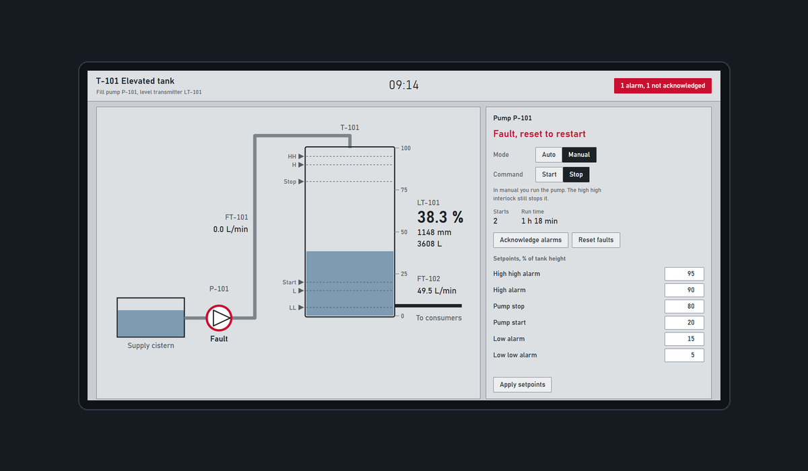
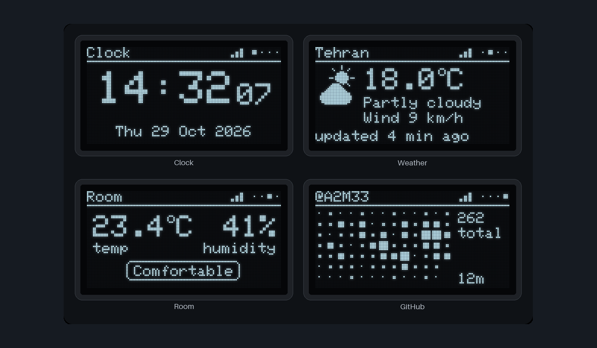
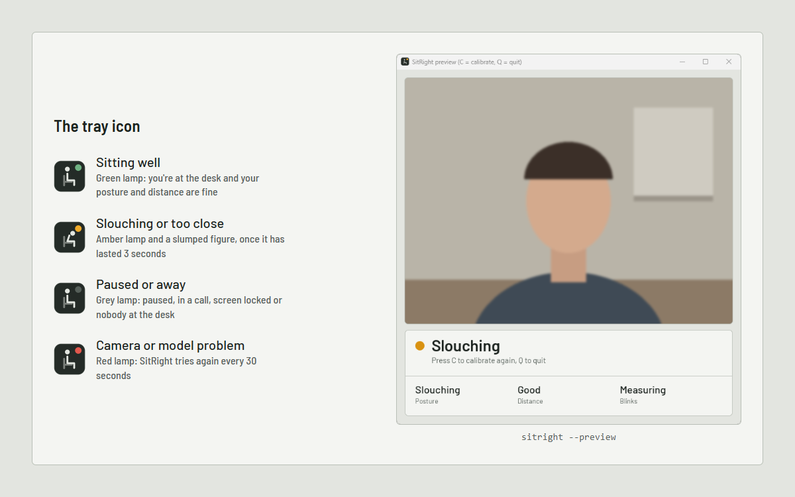

<picture>
  <source media="(prefers-color-scheme: dark)" srcset="https://raw.githubusercontent.com/A2M33/A2M33/output/header-dark.svg">
  
</picture>

  
  
  

I like code that reaches into the physical world: a PLC program that keeps a water tank from running dry, an ESP32 display on my desk, a webcam that notices you slouching.

**Goal:** an Ausbildung in Germany as a Fachinformatiker or in Automatisierungstechnik.

## Projects

<table>
  <tr>
    <td width="33%" valign="top">
      
      <h3><a href="https://github.com/A2M33/tanksim">tanksim</a></h3>
      PLC-run water tank with alarms, Modbus TCP and an operator HMI. <a href="https://a2m33.github.io/tanksim/">Try it ↗</a>
        <code>Python</code> <code>Modbus</code>
    </td>
    <td width="33%" valign="top">
      
      <h3><a href="https://github.com/A2M33/deskpal">deskpal</a></h3>
      ESP32 desk display with clock, weather, room climate and my GitHub grid.
        <code>C++</code> <code>ESP32</code>
    </td>
    <td width="33%" valign="top">
      
      <h3><a href="https://github.com/A2M33/sitright">sitright</a></h3>
      Webcam posture, blink and break reminders. Runs offline.
        <code>Python</code> <code>MediaPipe</code>
    </td>
  </tr>
</table>

<a href="https://github.com/A2M33?tab=repositories">More projects →</a>

## Tech stack

<table align="center">
  <tr>
    <td align="right"><b>Languages</b></td>
    <td><picture>
      <source media="(prefers-color-scheme: light)" srcset="https://skillicons.dev/icons?i=python,c,cpp,js,html,css,bash,powershell&theme=light">
      
    </picture></td>
  </tr>
  <tr>
    <td align="right"><b>AI &amp; hardware</b></td>
    <td><picture>
      <source media="(prefers-color-scheme: light)" srcset="https://skillicons.dev/icons?i=opencv,pytorch,sklearn,arduino,raspberrypi&theme=light">
      
    </picture></td>
  </tr>
  <tr>
    <td align="right"><b>Tools</b></td>
    <td><picture>
      <source media="(prefers-color-scheme: light)" srcset="https://skillicons.dev/icons?i=linux,ubuntu,git,github,vscode,sqlite,nodejs&theme=light">
      
    </picture></td>
  </tr>
</table>

Persian (native) · English (fluent) · Deutsch (learning)

