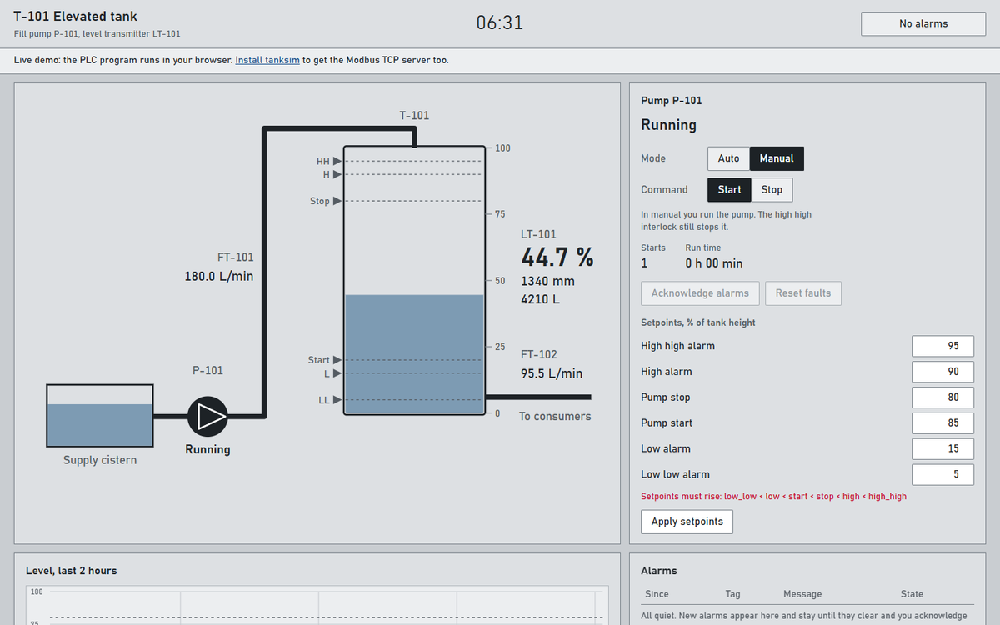
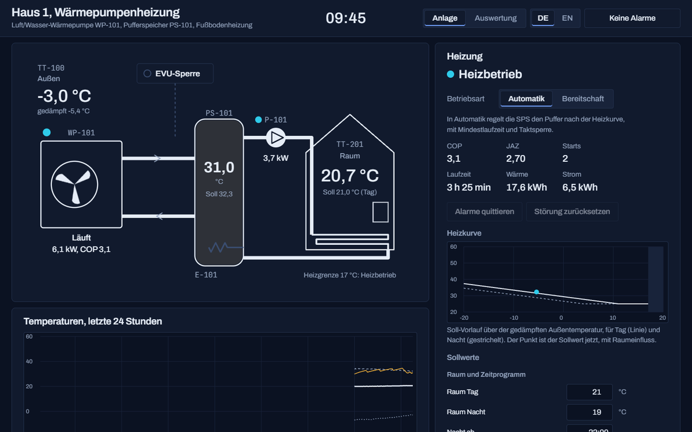
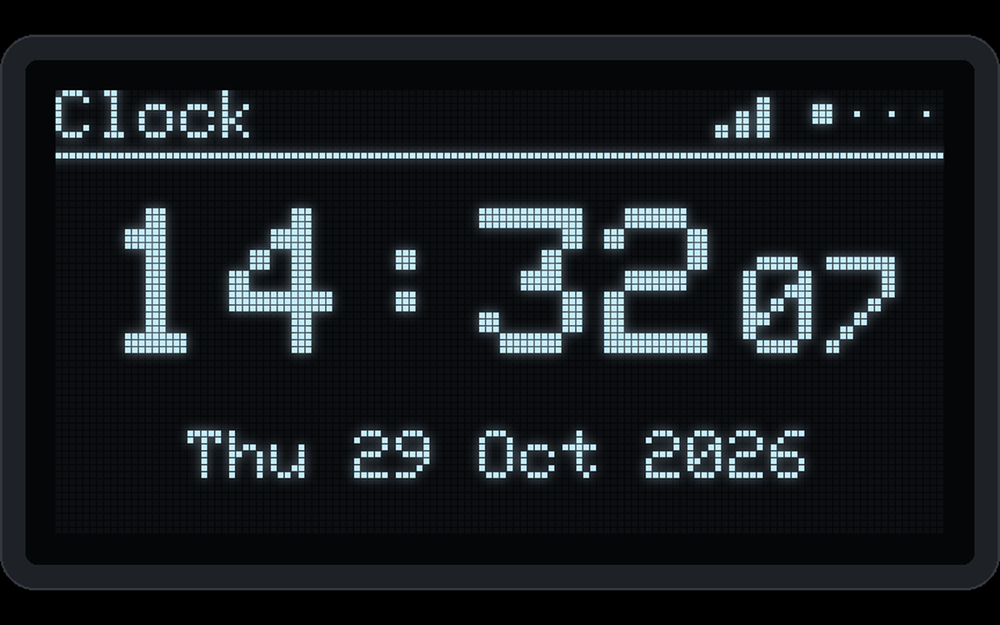
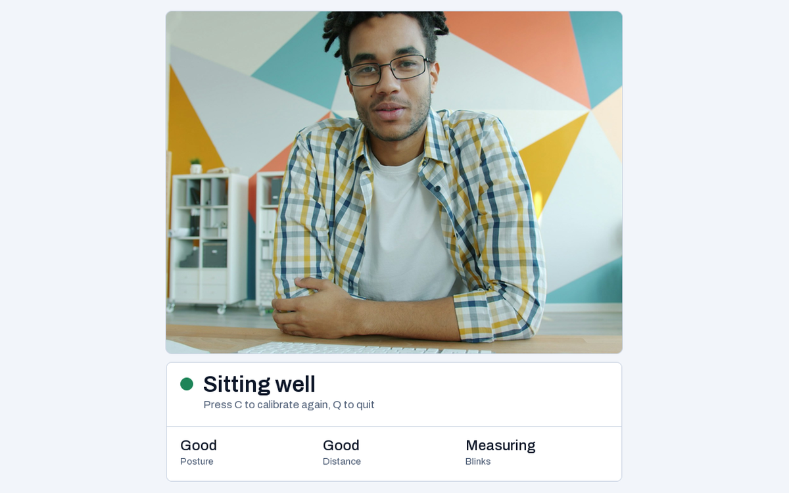

# Amin Mohammadi

I live in Tehran and write Python and some C++. Most of my projects control or measure something: a PLC program that keeps a water tank between its alarm levels, a heat pump in a simulated house, an ESP32 display on my desk.

I want to start an Ausbildung in Germany, as Fachinformatiker or in Automatisierungstechnik.

[Email](mailto:a2m33business@gmail.com) · [X](https://x.com/A2M33_)

## Projects

<table>
  <tr>
    <td width="50%" valign="top">
      
       <a href="https://github.com/A2M33/tanksim"><b>tanksim</b></a>: a water tank and fill pump run by a small PLC program, with alarms, a Modbus TCP server and an operator HMI. <a href="https://a2m33.github.io/tanksim/">Live demo</a>
    </td>
    <td width="50%" valign="top">
      
       <a href="https://github.com/A2M33/haussim"><b>haussim</b></a>: a house heated by an air/water heat pump, controlled by a PLC program. The HMI speaks German and English. <a href="https://a2m33.github.io/haussim/">Live demo</a>
    </td>
  </tr>
  <tr>
    <td width="50%" valign="top">
      
       <a href="https://github.com/A2M33/deskpal"><b>deskpal</b></a>: ESP32 firmware for a small OLED on my desk. It shows the time, the weather, the room climate and my GitHub contributions.
    </td>
    <td width="50%" valign="top">
      
       <a href="https://github.com/A2M33/sitright"><b>sitright</b></a>: a tray app that checks your posture through the webcam and tells you when to sit up or take a break. It runs offline.
    </td>
  </tr>
</table>

Smaller things:

- [artikel](https://github.com/A2M33/artikel): practise der, die and das on 909 German nouns, with English and Persian meanings
- [practicemeter](https://github.com/A2M33/practicemeter): a practice timer for musicians that only counts the minutes you play
- [spacetrail](https://github.com/A2M33/spacetrail): find out which folders grew on your disk this week
- [histpick](https://github.com/A2M33/histpick): pick commands from your shell history and save them as a script
- [mixinsmith](https://github.com/A2M33/mixinsmith): lets coding agents look up the real Minecraft mod API of your project

## Tech stack

<table align="center">
  <tr>
    <td align="right"><b>Languages</b></td>
    <td></td>
  </tr>
  <tr>
    <td align="right"><b>AI &amp; hardware</b></td>
    <td></td>
  </tr>
  <tr>
    <td align="right"><b>Tools</b></td>
    <td></td>
  </tr>
</table>

Persian is my first language. I speak English and I'm learning German.
