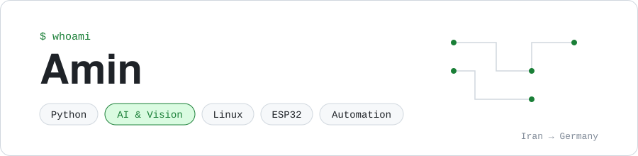

<picture>
  <source media="(prefers-color-scheme: dark)" srcset="assets/header-v2-dark.svg">
  
</picture>

  
  
   
  

### Hi, I'm Amin 👋

I'm from Tehran and I'm preparing for an Ausbildung in Germany, as a Fachinformatiker or in industrial automation. I like projects where code touches the physical world, like a webcam that notices you slouching or the ESP32 desk display I'm building now.

I build small tools people can use and commit as I go, so the history in each repo shows how it came together.

### Projects

| Project | What it does | Built with |
| --- | --- | --- |
| [artikel](https://github.com/A2M33/artikel) · [try it](https://a2m33.github.io/artikel/) | Practise der, die and das with 900+ German nouns, spaced repetition and English/Persian meanings | HTML, CSS, JavaScript |
| [practicemeter](https://github.com/A2M33/practicemeter) · [try it](https://a2m33.github.io/practicemeter/) | Practice timer for musicians that counts only the minutes you play, using the microphone in the browser | JavaScript, Web Audio |
| [spacetrail](https://github.com/A2M33/spacetrail) | Daily folder-size snapshots that tell you which folders ate your disk space this week | Python, SQLite |
| [deskpal](https://github.com/A2M33/deskpal) | ESP32 desk display with clock, weather, room climate and my GitHub contribution grid on a 128x64 OLED | C++, Arduino, ESP32 |
| [sitright](https://github.com/A2M33/sitright) | Tray app that watches your posture through the webcam and reminds you to sit up, blink and take breaks; runs offline | Python, MediaPipe, OpenCV |

### Currently building

- Recording deskpal running in the Wokwi simulator
- A demo GIF for sitright

### Skills

<table>
  <tr>
    <th>Working with</th>
    <th>Learning now</th>
    <th>Next up</th>
  </tr>
  <tr>
    <td valign="top">
      
      
      
      
       
      
      
      
    </td>
    <td valign="top">
      
      
      
      
       
      
      
      
       
      
      
      
    </td>
    <td valign="top">
      
      
      
      
       
      
    </td>
  </tr>
</table>

### Languages

### Tools I like

### Über mich

Ich heiße Amin und komme aus Teheran. Ich lerne Deutsch (Ziel: B2) und bereite mich auf eine Ausbildung als Fachinformatiker oder in der Automatisierungstechnik vor. Hier dokumentiere ich meine Projekte und meinen Lernfortschritt.
