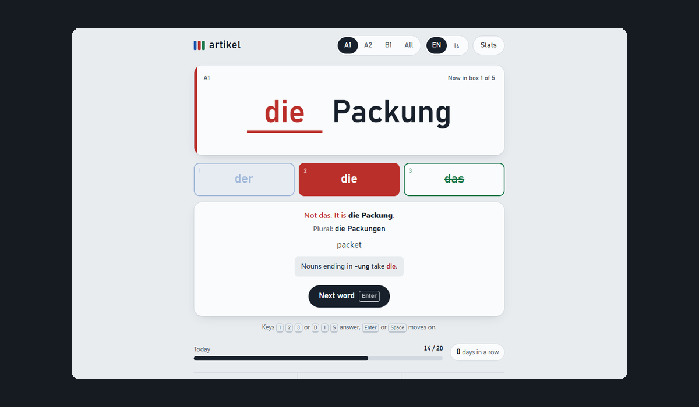

<picture>
  <source media="(prefers-color-scheme: dark)" srcset="https://raw.githubusercontent.com/A2M33/A2M33/output/header-dark.svg">
  
</picture>

  

  
  
  

I like code that reaches into the physical world: a webcam that notices you slouching, an ESP32 display on my desk, a PLC program that keeps a water tank from running dry. I build small tools people can use and commit as I go.

🎯 **Goal:** an Ausbildung in Germany as a Fachinformatiker or in Automatisierungstechnik.

## Featured projects

<table>
  <tr>
    <td width="50%" valign="top">
      
      <h3><a href="https://github.com/A2M33/tanksim">tanksim</a></h3>
      A water tank and pump run by a PLC program, with interlocks, alarms, a Modbus TCP server and an operator HMI. <a href="https://a2m33.github.io/tanksim/">Try it ↗</a>
        <code>Python</code> <code>Modbus TCP</code> <code>PLC logic</code>
    </td>
    <td width="50%" valign="top">
      
      <h3><a href="https://github.com/A2M33/deskpal">deskpal</a></h3>
      ESP32 desk display with clock, weather, room climate and my GitHub grid.
        <code>C++</code> <code>ESP32</code>
    </td>
  </tr>
  <tr>
    <td width="50%" valign="top">
      
      <h3><a href="https://github.com/A2M33/sitright">sitright</a></h3>
      Webcam posture, blink and break reminders. Runs offline.
        <code>Python</code> <code>MediaPipe</code>
    </td>
    <td width="50%" valign="top">
      
      <h3><a href="https://github.com/A2M33/artikel">artikel</a></h3>
      Der, die, das trainer with 900+ nouns and spaced repetition. <a href="https://a2m33.github.io/artikel/">Try it ↗</a>
        <code>JavaScript</code> <code>PWA</code>
    </td>
  </tr>
</table>

## All projects

**Hardware & automation**
- [tanksim](https://github.com/A2M33/tanksim): PLC-run water tank with Modbus TCP and a browser HMI
- [deskpal](https://github.com/A2M33/deskpal): ESP32 OLED desk display, runs in Wokwi

**Desktop & CLI tools**
- [sitright](https://github.com/A2M33/sitright): webcam posture, blink and break reminders
- [clickforge](https://github.com/A2M33/clickforge): rebindable auto clicker with a Stream Deck plugin
- [histpick](https://github.com/A2M33/histpick): pick commands from your shell history and save them as a script
- [spacetrail](https://github.com/A2M33/spacetrail): daily disk snapshots that show which folders grew

**Web apps**
- [artikel](https://github.com/A2M33/artikel): der, die, das trainer with spaced repetition
- [practicemeter](https://github.com/A2M33/practicemeter): practice timer that counts only the minutes you play

**Minecraft**
- [mixinsmith](https://github.com/A2M33/mixinsmith): look up the real Minecraft, Fabric and NeoForge API for AI coding agents
- [villagerswarm](https://github.com/A2M33/villagerswarm): Fabric mod where villagers chase you on command

## Tech stack

<table align="center">
  <tr>
    <td align="right"><b>Languages</b></td>
    <td></td>
  </tr>
  <tr>
    <td align="right"><b>AI &amp; hardware</b></td>
    <td></td>
  </tr>
  <tr>
    <td align="right"><b>Tools</b></td>
    <td></td>
  </tr>
</table>

Persian (native) · English (fluent) · Deutsch (learning)

