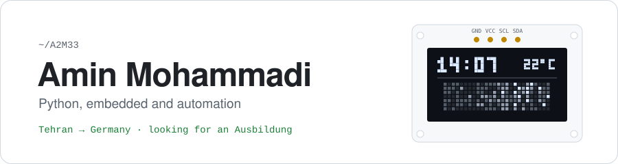

<picture>
  <source media="(prefers-color-scheme: dark)" srcset="assets/header-v3-dark.svg">
  
</picture>

 <samp>
<a href="https://www.linkedin.com/in/amin-mohammadi-a2m33/">linkedin</a> ·
<a href="mailto:a2m33business@gmail.com">email</a> ·
<a href="#über-mich">deutsch</a>
</samp>

I build small tools where code meets hardware: a webcam that catches you slouching, an ESP32 display on my desk. Each repo keeps its full commit history, so you can see how it grew.

**Projects**

- **[sitright](https://github.com/A2M33/sitright)**: posture, blink and break reminders from your webcam, offline `Python` `MediaPipe`
- **[deskpal](https://github.com/A2M33/deskpal)**: ESP32 desk display with clock, weather, room climate and my contribution grid `C++` `ESP32`
- **[artikel](https://github.com/A2M33/artikel)**: der, die, das trainer with 900+ nouns and spaced repetition · [open](https://a2m33.github.io/artikel/) `JavaScript`
- **[practicemeter](https://github.com/A2M33/practicemeter)**: practice timer for musicians that counts only the minutes you play · [open](https://a2m33.github.io/practicemeter/) `Web Audio`
- **[clickforge](https://github.com/A2M33/clickforge)**: one mouse click becomes many, with a Stream Deck plugin `Python` `Win32`
- **[spacetrail](https://github.com/A2M33/spacetrail)**: shows which folders ate your disk space this week `Python` `SQLite`
- **[histpick](https://github.com/A2M33/histpick)**: turn commands from your shell history into a script `Python`

**Now**: running deskpal in the Wokwi simulator and recording a demo for sitright.

<samp>Python · Linux · Bash · Git · learning OpenCV, PyTorch, C++ and Arduino Persian (native) · English (fluent) · Deutsch (learning, aiming for B2)</samp>

#### Über mich

Ich heiße Amin und komme aus Teheran. Ich lerne Deutsch (Ziel: B2) und bereite mich auf eine Ausbildung als Fachinformatiker oder in der Automatisierungstechnik vor. Hier dokumentiere ich meine Projekte und meinen Lernfortschritt.
