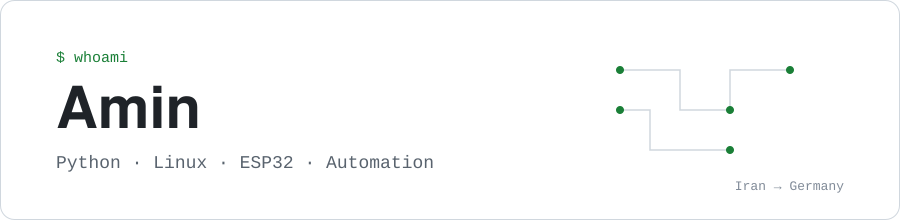

<picture>
  <source media="(prefers-color-scheme: dark)" srcset="assets/header-dark.svg">
  
</picture>

### Hi, I'm Amin

I'm from Iran and I'm preparing for an Ausbildung in Germany, as a Fachinformatiker or in industrial automation. I build small, real tools where software meets hardware: Python on Linux, ESP32 sensors, and PLC experiments.

I commit as I learn, so the history in these repos shows my actual progress.

**Learning now:** Python, computer vision, Linux, networking, ESP32, German

### Tech I work and learn with

**AI & computer vision** 

**Hardware & embedded** 

**Systems & tools** 

**3D & web** 

### Über mich

Ich heiße Amin und komme aus dem Iran. Ich lerne Deutsch (Ziel: B2) und bereite mich auf eine Ausbildung als Fachinformatiker oder in der Automatisierungstechnik vor. Hier dokumentiere ich meine Projekte und meinen Lernfortschritt.
