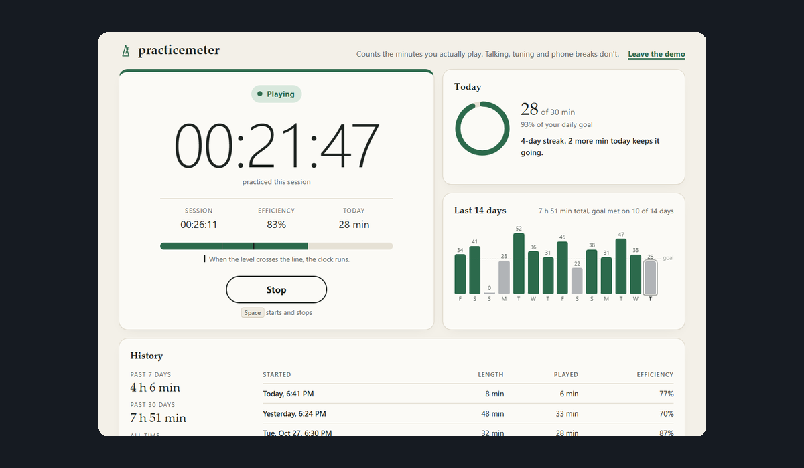
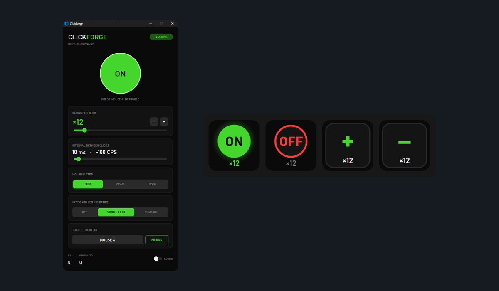
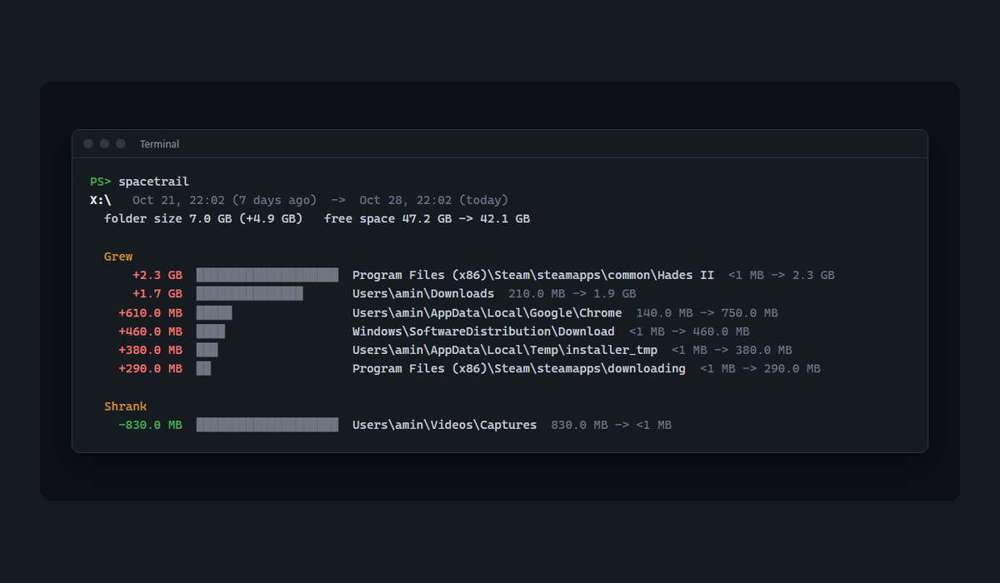
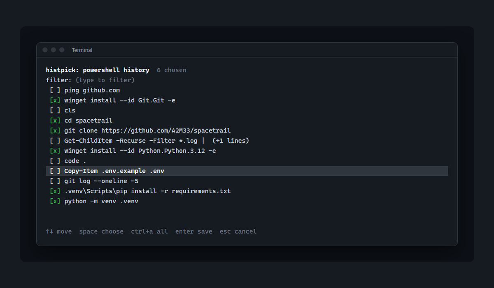

<picture>
  <source media="(prefers-color-scheme: dark)" srcset="assets/header-v4-dark.svg">
  
</picture>

  

  
  
  

 

<table align="center">
  <tr><td><b>Looking for</b></td><td>Ausbildung as Fachinformatiker or in Automatisierungstechnik</td></tr>
  <tr><td><b>Based in</b></td><td>Tehran, Iran · moving to Germany</td></tr>
  <tr><td><b>Languages</b></td><td>Persian (native) · English (fluent) · Deutsch (learning, aiming for B2)</td></tr>
  <tr><td><b>Work style</b></td><td>Small tools people can use, most with tests in CI, committed step by step</td></tr>
</table>

## 🛠️ Projects

<table>
  <tr>
    <td width="50%" valign="top">
      
      <h3><a href="https://github.com/A2M33/sitright">sitright</a></h3>
      Tray app that watches your posture through the webcam and reminds you to sit up, blink and take breaks. Runs offline.
        <code>Python</code> <code>MediaPipe</code> <code>OpenCV</code>
    </td>
    <td width="50%" valign="top">
      
      <h3><a href="https://github.com/A2M33/deskpal">deskpal</a></h3>
      ESP32 desk display with clock, weather, room climate and my GitHub contribution grid on a 128x64 OLED.
        <code>C++</code> <code>Arduino</code> <code>ESP32</code>
    </td>
  </tr>
  <tr>
    <td width="50%" valign="top">
      
      <h3><a href="https://github.com/A2M33/artikel">artikel</a> · <a href="https://a2m33.github.io/artikel/">open ↗</a></h3>
      Practise der, die and das with 900+ German nouns, spaced repetition and English/Persian meanings.
        <code>JavaScript</code> <code>PWA</code>
    </td>
    <td width="50%" valign="top">
      
      <h3><a href="https://github.com/A2M33/practicemeter">practicemeter</a> · <a href="https://a2m33.github.io/practicemeter/">open ↗</a></h3>
      Practice timer for musicians that counts only the minutes you play, using the microphone in the browser.
        <code>JavaScript</code> <code>Web Audio</code>
    </td>
  </tr>
  <tr>
    <td width="50%" valign="top">
      
      <h3><a href="https://github.com/A2M33/clickforge">clickforge</a></h3>
      Windows tool that turns one mouse click into many, with a keyboard-LED status light and a Stream Deck plugin.
        <code>Python</code> <code>Win32</code> <code>Node.js</code>
    </td>
    <td width="50%" valign="top">
      
      <h3><a href="https://github.com/A2M33/spacetrail">spacetrail</a></h3>
      Daily folder-size snapshots that show which folders ate your disk space this week.
        <code>Python</code> <code>SQLite</code>
    </td>
  </tr>
  <tr>
    <td width="50%" valign="top">
      
      <h3><a href="https://github.com/A2M33/histpick">histpick</a></h3>
      Pick commands from your shell history and save them as a script for PowerShell, bash, zsh or fish.
        <code>Python</code> <code>CLI</code>
    </td>
    <td width="50%" valign="middle" align="center">
      <b>Now</b>  
      Running deskpal in the Wokwi simulator 
      Recording a demo for sitright
        
      
    </td>
  </tr>
</table>

## ⚙️ Tech stack

<table align="center">
  <tr>
    <td align="center" width="96"> Python</td>
    <td align="center" width="96"> C++</td>
    <td align="center" width="96"> JavaScript</td>
    <td align="center" width="96"> Linux</td>
    <td align="center" width="96"> Arduino</td>
    <td align="center" width="96"> OpenCV</td>
    <td align="center" width="96"> Git</td>
  </tr>
</table>

Learning now: PyTorch, scikit-learn, Raspberry Pi · Next: Docker, TensorFlow

## 📈 Activity

<picture>
  <source media="(prefers-color-scheme: dark)" srcset="https://raw.githubusercontent.com/A2M33/A2M33/output/snake-dark.svg">
  
</picture>

## 🇩🇪 Kurzprofil

Ich heiße Amin und komme aus Teheran. Ich lerne Deutsch (Ziel: B2) und suche eine Ausbildung als Fachinformatiker oder in der Automatisierungstechnik. Am liebsten baue ich Programme, die mit Hardware arbeiten: eine Haltungs-App mit Webcam oder ein ESP32-Display für den Schreibtisch. Die meisten Projekte haben automatische Tests, und jedes zeigt seine vollständige Commit-Historie.

<a href="mailto:a2m33business@gmail.com">a2m33business@gmail.com</a>

