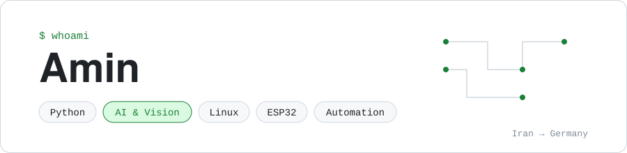

<picture>
  <source media="(prefers-color-scheme: dark)" srcset="assets/header-v2-dark.svg">
  
</picture>

  <samp>
    <a href="https://www.linkedin.com/in/amin-mohammadi-a2m33/">linkedin</a> ·
    <a href="mailto:a2m33business@gmail.com">email</a> ·
    <a href="#projects">projects</a> ·
    <a href="#über-mich">deutsch</a>
  </samp>

 

I'm Amin, from Tehran, preparing for an Ausbildung in Germany as a Fachinformatiker or in industrial automation. I like projects where code touches the physical world, like a webcam that notices you slouching or an ESP32 display on my desk.

I build small tools people can use and commit as I go, so each repo's history shows how it came together.

### Projects

- **[sitright](https://github.com/A2M33/sitright)**: tray app that watches your posture through the webcam and reminds you to sit up, blink and take breaks, all offline. `Python` `MediaPipe` `OpenCV`
- **[deskpal](https://github.com/A2M33/deskpal)**: ESP32 desk display with clock, weather, room climate and my GitHub contribution grid on a 128x64 OLED. `C++` `Arduino` `ESP32`
- **[artikel](https://github.com/A2M33/artikel)** · [try it](https://a2m33.github.io/artikel/): practise der, die and das with 900+ German nouns, spaced repetition and English/Persian meanings. `HTML` `CSS` `JavaScript`
- **[practicemeter](https://github.com/A2M33/practicemeter)** · [try it](https://a2m33.github.io/practicemeter/): practice timer for musicians that counts only the minutes you play, using the browser microphone. `JavaScript` `Web Audio`
- **[clickforge](https://github.com/A2M33/clickforge)**: Windows tool that turns one mouse click into many, with a rebindable toggle, a keyboard-LED status light and a Stream Deck plugin. `Python` `Win32` `Node.js`
- **[spacetrail](https://github.com/A2M33/spacetrail)**: daily folder-size snapshots that show which folders ate your disk space this week. `Python` `SQLite`
- **[histpick](https://github.com/A2M33/histpick)**: pick commands from your shell history and save them as a script for PowerShell, bash, zsh or fish. `Python`

### Now

- Recording deskpal running in the Wokwi simulator
- A demo GIF for sitright

### Stack

<samp>
daily: Python · Linux · Bash · Git 
learning: OpenCV · PyTorch · scikit-learn · Arduino · C/C++ · JavaScript 
next: TensorFlow · Docker · Three.js · Blender 
languages: Persian (native) · English (fluent) · Deutsch (learning, aiming for B2)
</samp>

### Über mich

Ich heiße Amin und komme aus Teheran. Ich lerne Deutsch (Ziel: B2) und bereite mich auf eine Ausbildung als Fachinformatiker oder in der Automatisierungstechnik vor. Hier dokumentiere ich meine Projekte und meinen Lernfortschritt.
